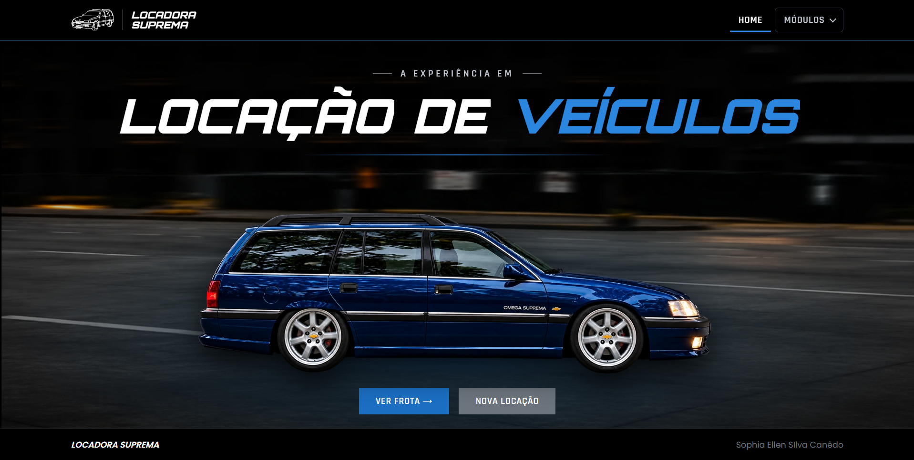
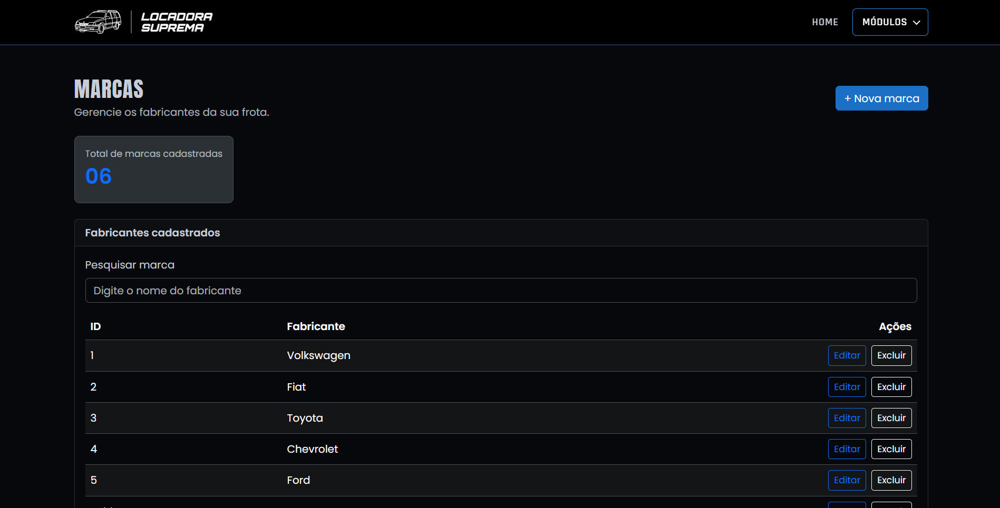
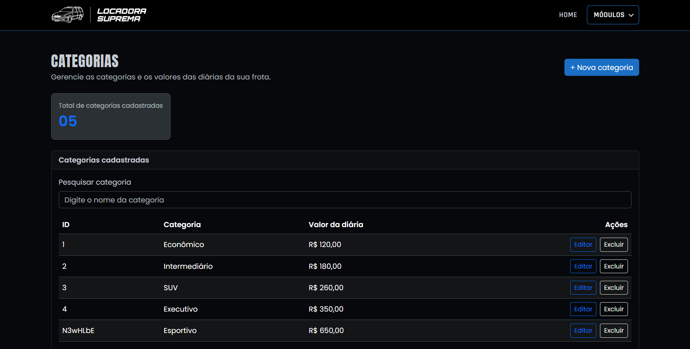
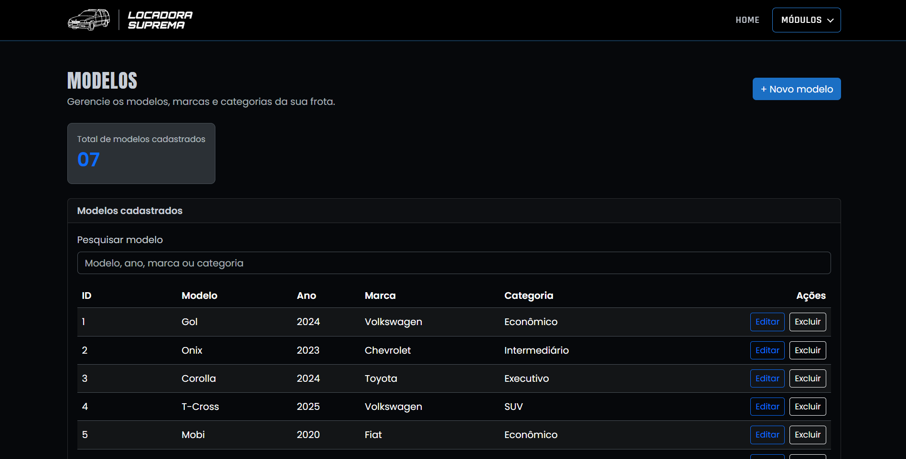
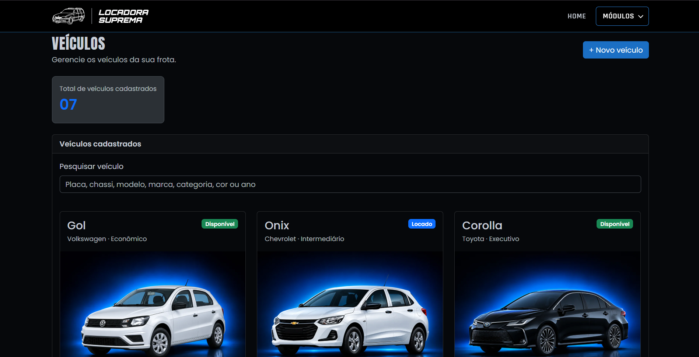
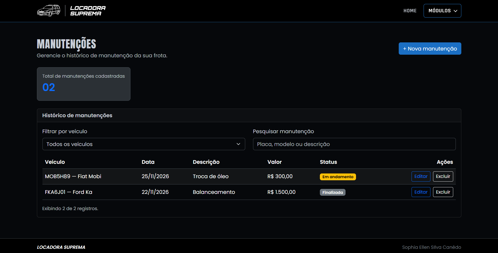
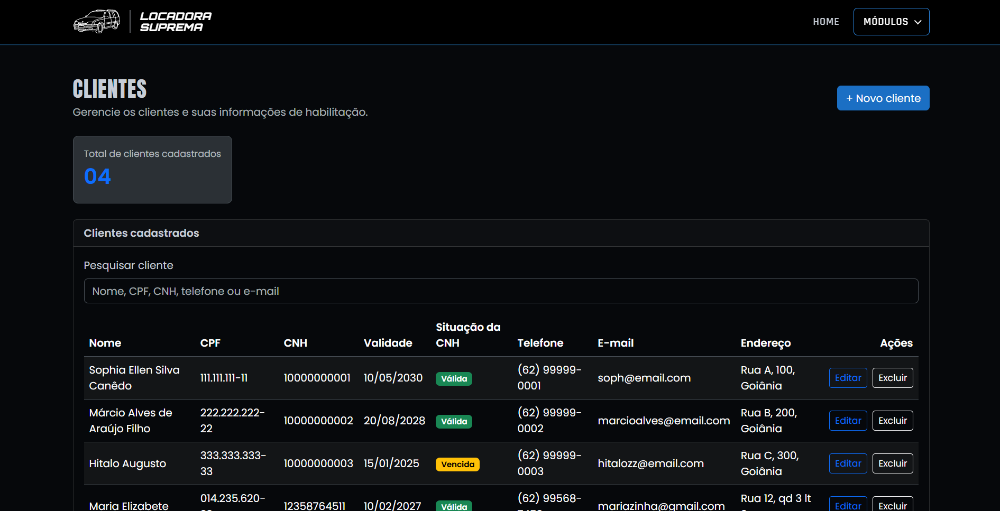
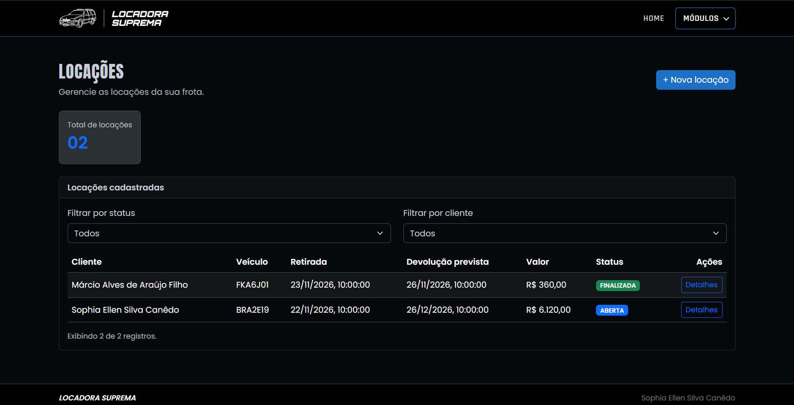

<div align="center">

# LOCADORA SUPREMA

### Sistema de Locação de Veículos

Aplicação web para gerenciar a frota, os clientes e todo o ciclo de locação, da retirada do veículo à devolução, aos pagamentos e à emissão da nota fiscal simulada.


</div>

---

- Sophia Ellen Silva Canêdo

Ciência da Computação · PUC Goiás  
Atividade de laboratório N2 — Sistema de Locação de Veículos

| LOCADORA SUPREMA |
| :---: |
|  |


A Locadora Suprema reúne os cadastros de marcas, categorias, modelos, veículos, manutenções e clientes. O módulo de locações integra dados para calcular o valor previsto, gerar contratos, registrar vistorias e pagamentos, emitir notas fiscais simuladas e controlar a disponibilidade da frota.

| Etapa | Conteúdo 
| :---: | :---: |
| 1 | Home, identidade visual, animações e navegação 
| 2 | Cadastros de marcas, categorias e modelos 
| 3 | Cadastros de veículos, manutenções e clientes 
| 4 | Locação, contrato, vistorias, pagamentos e nota fiscal simulada 
| 5 | Consultas, filtros e disponibilidade 
| 6 | Cards da frota, máscaras e responsividade 

## Como executar

Na pasta que contém o `package.json`, instale as dependências:

```bash
npm install
```

Para iniciar o sistema:

```bash
npm start
```

O `concurrently` inicia a API e o Vite no mesmo terminal. A API utiliza a porta `3001` e o Vite abre a aplicação automaticamente no navegador.

Caso seja necessário abrir a aplicação manualmente, acesse:

- Interface: http://localhost:5173
- API: http://localhost:3001


### Execução em terminais separados

Terminal 1 — API:

```bash
npm run server
```

Terminal 2 — Interface:

```bash
npm run dev
```

### Observação

O arquivo `db.json` contém os dados da aplicação e é responsável pela persistência dos registros.

## O que tem na Home

- **Hero animado:** apresentação da identidade Locadora Suprema, movimentos suaves dos elementos visuais conforme a interação do usuário, com animações desenvolvidas utilizando GSAP
- **Identidade visual:** combinação de tons escuros, azul e prata, proporcionando uma interface moderna e consistente
- **Acesso rápido:** botões para visualização e criação utilizando bootstrap
- **Navegação compartilhada:** acesso aos módulos do sistema através da Navbar usando componentes do bootstrap
- **Responsividade:** interface adaptável a computadores, tablets e dispositivos móveis

## Funcionalidades implementadas

| Módulo | O que o usuário pode fazer |
| --- | --- |
| **Marcas** | Cadastrar, listar, editar e excluir marcas |
| **Categorias** | Gerenciar categorias e definir o valor da diária |
| **Modelos** | Vincular cada modelo à sua marca e categoria |
| **Veículos** | Gerenciar a frota através de cards com fotografias e informações dos veículos |
| **Manutenções** | Registrar manutenções e consultar o histórico de cada veículo |
| **Clientes** | Gerenciar dados pessoais e de habilitação com máscaras e validações |
| **Locações** | Registrar locações, calcular diárias e consultar contratos |
| **Vistorias** | Registrar as condições do veículo na retirada e na devolução |
| **Pagamentos** | Registrar múltiplos pagamentos e acompanhar a situação financeira |
| **Nota fiscal** | Emitir uma nota fiscal simulada por locação finalizada |
| **Consultas** | Filtrar locações por cliente e status e acompanhar a disponibilidade da frota |

## Fluxo de uma locação

1. **Escolha do cliente e do veículo.** Selecione um cliente com CNH válida, um veículo disponível e o período da locação.

2. **Cálculo e registro.** O sistema calcula automaticamente o valor previsto multiplicando a quantidade de diárias pelo valor da categoria. O contrato é gerado automaticamente com um número único e a data de emissão.

3. **Vistoria de retirada.** São registradas a quilometragem inicial, o nível de combustível e as observações sobre as condições do veículo.

4. **Devolução.** Ao receber o veículo, são registradas a data real de devolução, a quilometragem final, o nível de combustível e as observações. O sistema recalcula o valor total, atualiza a quilometragem do veículo e finaliza a locação.

5. **Pagamentos.** É possível registrar um ou mais pagamentos e acompanhar o saldo restante. Somente pagamentos com status `PAGO` são contabilizados no total recebido.

6. **Nota fiscal simulada.** Após a finalização da locação, o sistema permite emitir uma única nota fiscal com número exclusivo, série, data de emissão e valor final.

A situação financeira é independente do status operacional da locação. Dessa forma, um veículo pode ser devolvido e disponibilizado novamente mesmo que existam pagamentos pendentes, desde que não esteja em manutenção.

## Tecnologias

| Tecnologia | Uso no projeto |
| --- | --- |
| **React + Vite** | Interface da aplicação, ambiente de desenvolvimento e build |
| **TypeScript** | Tipagem das propriedades dos componentes, entidades e serviços |
| **React Router** | Navegação entre as páginas |
| **Bootstrap** | Layout, componentes visuais e responsividade |
| **Axios** | Requisições HTTP concentradas na camada de serviços |
| **JSON Server** | API REST simulada com persistência em `db.json` |
| **GSAP** | Animações e interações visuais da Home |
| **Concurrently** | Execução da API e do Vite com um único comando |
| **ESLint** | Verificação e padronização do código |
| **Git e GitHub** | Controle de versão e histórico de desenvolvimento |

## Estrutura de pastas

```text
locadora-veiculos/
├── prints/                 #capturas das telas principais
│       
├── src/
│   ├── assets/             # Imagens e elementos visuais
│   │   └── frota/          # Fotos dos veículos em WebP
│   ├── components/         # Componentes reutilizáveis
│   ├── models/             # Interfaces das entidades
│   ├── pages/
│   │   ├── Home.tsx
│   │   ├── marcas/
│   │   ├── categorias/
│   │   ├── modelos/
│   │   ├── veiculos/
│   │   ├── manutencoes/
│   │   ├── clientes/
│   │   └── locacoes/
│   │       ├── LocacaoList.tsx
│   │       ├── LocacaoForm.tsx
│   │       ├── LocacaoConsulta.tsx
│   │       ├── DevolucaoForm.tsx
│   │       ├── PagamentoForm.tsx
│   │       └── NotaFiscal.tsx
│   ├── service/
│   │   ├── api.ts          # Configuração da API
│   │   ├── crudService.ts  # Serviço CRUD genérico
│   │   └── ...             # Serviços das entidades
│   ├── utils/
│   │   └── mascaras.ts      # Funções de formatação
│   ├── App.tsx             # Rotas da aplicação
│   ├── main.tsx            # Ponto de entrada
│   └── base.css            # Estilos globais
├── db.json                 # Banco de dados simulado
├── package.json            # Dependências e scripts
├── tsconfig.json           # Configuração do TypeScript
├── tsconfig.app.json       # Configuração da aplicação
├── .gitignore
└── README.md
```
 
## Capturas de tela

### Página inicial


### Marcas



### Categorias



### Modelos



### Frota de veículos



### Manutenções



### Clientes



### Locações




---

<div align="center">

<strong>LOCADORA SUPREMA</strong>

Projeto acadêmico · Ciência da Computação · PUC Goiás

Desenvolvido para a atividade de laboratório de Sistema de Locação de Veículos.

</div>